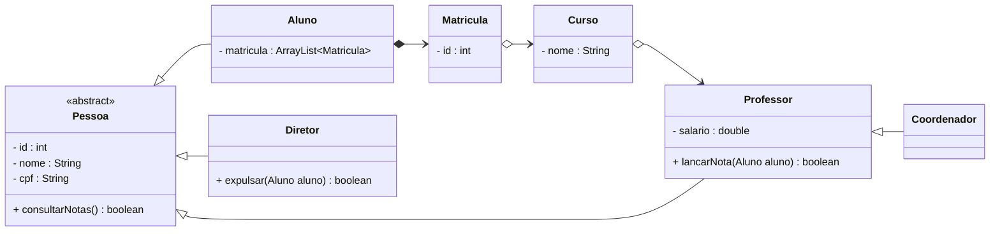
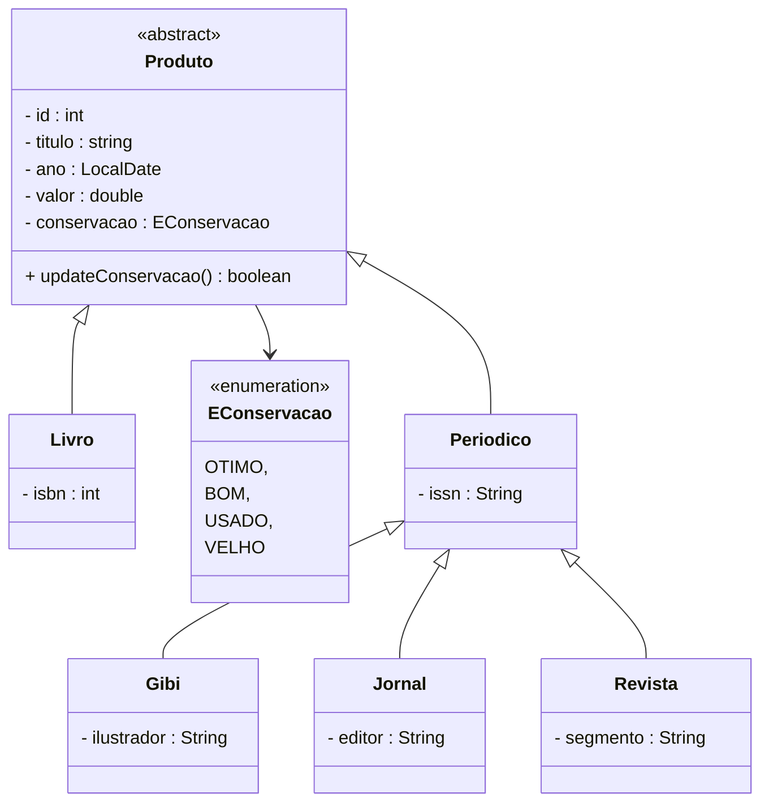
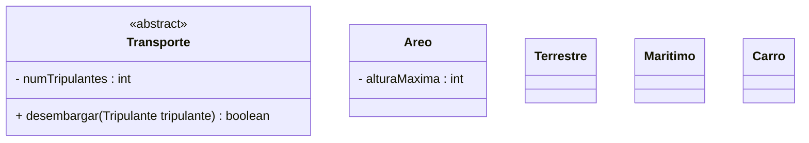

# Exericicios de diagrama de classes - Herança

## Diagramas para um Sistema de Informação: 

### Sistema Acadêmico

### Biblioteca

## Diagrama para um Sistema de jogo: 

### Simulador de Transportes

