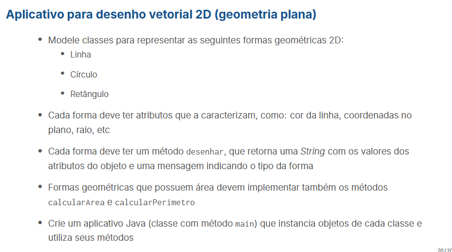

# Exercício 2



## Diagrama de classe

````mermaid
classDiagram
    class Coordenada {
        - x : int
        - y : int
    }
    
    class Geometrica {
        <<abstract>>
        - cor : String
        - coordenadaInicial : Coordenada
        + desenhar() String
    }
    
    class Linha {
        - coordenadaFinal : Coordenada
    }
    
    class FormaPlana {
        - base : int
        - altura : int
        + calcularArea() int
        + calcularPerimetro() int
    }
    
    class Circulo {
        - raio : double
    }
    
    class Retangulo {
        - coordenadaFinal : Coordenada
    }
    
    Geometrica --> Coordenada
    Geometrica <|-- FormaPlana
    FormaPlana <|-- Circulo
    Geometrica <|-- Linha
    FormaPlana <|-- Retangulo 
    Linha --> Coordenada
    Retangulo --> Coordenada
````